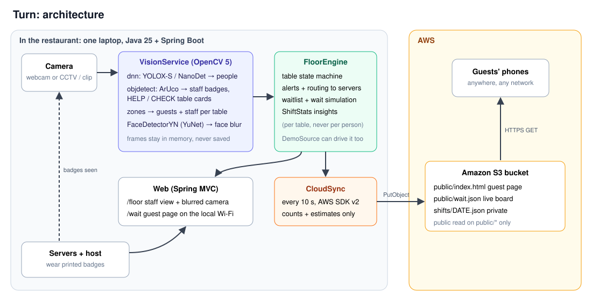

# Turn: technical report

**Team:** Sid (vision pipeline, floor engine, AWS, evaluation) and Basu (front end design).

Turn runs a restaurant floor from one camera. It keeps every table live, routes each task to the right server, and clears the alert when a server actually walks over, which the camera knows from a printed badge. The host gets a floor map, a server rotation and a waitlist. The owner gets a Shift Flow view. Guests get an estimated wait time on their own phone. Turn is built in Java 25 with OpenCV 5. Video never leaves the restaurant: AWS serves guests (S3) and a hosted demo (EC2, CloudFormation).

## Judge quickstart

| What | Where |
|---|---|
| Hosted demo (EC2) | The `DemoUrl` from the CloudFormation stack, listed in the Devpost "Try it out" links. Press **Restart demo** for a scripted two-minute, eight-table shift. Open **Shift flow** from the top bar |
| Guest wait page (S3) | https://turn-wait-sid.s3.amazonaws.com/public/index.html. It's fed by Turn running the real dining clip on our machine, so it shows "Not updated for a while" when that machine is off. The hosted demo's own board is at `public/demo/index.html` |
| Real vision on real footage | README, "Run it", then `-Dspring-boot.run.profiles=dining` |
| Proof that a badge clears an alert on real footage | §7.3 and `docs/img/badge-read.jpg` |
| Tests | `mvnw test` runs 24 tests |
| Pinned versions | §11 |

## 1. Problem

In a small, busy restaurant the host and servers can't watch every table. A table that sits ten minutes without a greeting, or waits five minutes for the check, is a guest who doesn't come back. Guests at the door get a guess ("about 20 minutes") that is often wrong.

Shire ([shireintelligence.com](https://shireintelligence.com), YC Fall 2026) solves the staff side. It turns a restaurant's CCTV into a live floor map for the host, routes tables to servers and reports on the shift. Turn does the same job and goes after the gaps:

| Gap in Shire's approach (from its public demo) | What Turn does instead |
|---|---|
| Guests see nothing | An **estimated wait page** on the guest's phone, served from S3, computed from what the tables are doing |
| Built around a CCTV system and a POS integration | **One ordinary camera** (webcam, phone or an existing CCTV stream over RTSP) and no POS |
| Labels waiters from video ("fastest flow", "needs support") | **Printed badges, not faces.** No face recognition, no per-person speed labels. Insights are per table and per alert type |
| Guests must catch someone's eye | **Table cards** (HELP / CHECK) the guest flips, which the camera reads |

## 2. Users

| User | What they get |
|---|---|
| Host | **Floor map** coloured by state, with server initials. **Server rotation** with "Next party". **Waitlist** with walk-in notes, a suggested table and server for each party, a quoted wait and one-tap Seat. **Reservations** with an Arrived button. **Block a table.** Double-seating is refused |
| Server | Alerts for their tables (Not greeted, Check in, Help, Check, Needs bussing), which clear by themselves when their badge is seen at the table |
| Owner | **Shift Flow**: covers, parties, tables turned, average turn time, peak, a timeline, "Do this next" actions, live floor signals, idle seats valued at the average check, server load as an operational view |
| Guest | An estimated wait on their phone, from anywhere (S3). On the restaurant Wi-Fi they can also join the list and see their place, and that page says when their table is ready |

## 3. Turn vs Shire, feature by feature

From Shire's public demo video. Shire's column shows what's visible in that video, not everything Shire has.

| Shire feature | Turn |
|---|---|
| Floor map with tables by shape, coloured Open / Seated / Dirty / Blocked, server initials | Yes. Tables are laid out from their camera zones and shaped by seats. Click a free table to block it |
| Server bar with each server's tables and "Next party" | Yes. Next party goes to the lightest-loaded server |
| Waitlist with suggested table, "fits N, server next", quoted time, notes like "birthday", Seat | Yes. Each party is offered a different table. A table isn't offered if it would waste more than two seats |
| Reservations tab, Arrived | Yes. Arrived moves the party to the front, and seats them if a table fits |
| Add walk-in | Yes, with a note |
| Counts: open, dirty, seated | Yes, at the host stand and on the map legend |
| Seated and dirty detection from the camera | Yes. People detection with OpenCV 5 dnn. Guests leaving makes the table Dirty, and a badge visit makes it Ready |
| "Check-ready" from the camera | A guest flips a CHECK card, read by ArUco. It's simpler and more reliable than guessing from posture |
| Shift Flow: covers, parties, turned, avg turn, peak hour, timeline | Yes |
| Recommendations ("Seat the Rivera party at T4", "Recover two dirty tables") | Yes. "Do this next" is worked out from the live floor every two seconds |
| Revenue opportunity (dollars at risk) | Yes, as idle seats and waiting covers times a configured average check, labelled as an estimate. No POS needed |
| Waiter load | Yes, as tables per server, explicitly not a ranking |
| Menu pricing guidance from POS data | **No, on purpose.** It needs a POS integration, which is the barrier Turn removes |
| Multi-camera NVR grid | Not yet. One camera per Turn instance (see Limitations) |
| **Guest-facing wait page** | Turn only |
| **Staff identity without faces** (badges) | Turn only |
| **Help / Check cards** | Turn only |
| **Faces blurred in every view, no frames stored** | Turn only |

## 4. Architecture

| Component | Role |
|---|---|
| `vision/VisionService` | Reads frames from a webcam (`camera:N`), a clip (`file:`) or any stream URL OpenCV's FFmpeg opens (RTSP from a CCTV recorder). It hands a frame to a **detection thread** every 200 ms. Every frame is drawn with the latest detections and streamed as **MJPEG** at the camera's frame rate. Until the first detection finishes, the preview is fully blurred |
| `vision/YoloxDetector`, `PersonDetector` | People detection with OpenCV 5 `dnn`: YOLOX-S (the default for wide rooms) or NanoDet (fast, for close cameras) |
| `vision/MarkerDetector` | OpenCV 5 `objdetect.ArucoDetector`, `DICT_4X4_50`. IDs 0 to 9 are staff badges, 20+n is HELP for table n, 30+n is CHECK |
| `vision/FaceBlurrer` | OpenCV 5 `FaceDetectorYN` (YuNet). Blurs every face YuNet finds. If a detected person has no face inside their box, the top 30% of the box is blurred instead |
| `VisionService.observe` | Pure logic between vision and the floor; unit-tested |
| `floor/FloorEngine` | Table states (Empty, Seated, Needs bussing, Ready, plus Blocked), alerts and routing, rotation, waitlist, reservations, wait simulation, Shift Flow |
| `web/*` | Spring MVC: `/floor`, `/flow`, `/wait`, `/login`, JSON APIs, the MJPEG stream, `/api/health`. An optional **staff PIN** (`turn.staff-pin`) locks everything except the guest wait page |
| `cloud/CloudSync` | AWS SDK v2. Writes the wait board and the shift summary to S3 every 10 s |
| `demo/DemoSource` | A scripted two-minute, eight-table service that drives the same engine without a camera, labelled DEMO everywhere |
| `infra/turn-demo.yaml` | CloudFormation for the hosted demo on EC2 |

**From a frame to a table.**
1. YOLOX finds people and ArUco finds markers in the same frame.
2. Each person counts for the table whose zone holds the centre of their box.
3. Each badge marks **one** person as staff: the person whose box (grown 10%) holds the badge and whose centre is nearest to it. A server leaning over a guest doesn't turn the guest into staff.
4. A badge inside a zone counts as a visit even if the detector missed the person wearing it.
5. HELP and CHECK cards count wherever they are in view.
6. That gives one `TableObservation(guests, staff badges, help, check)` per table, which goes to `FloorEngine.tick`.

**What a visit does.** The first badge to reach a newly seated table owns it. A badge visit clears Not greeted, Check in, Help and Check at that table. On a dirty table, a badge visit with no guests makes it Ready. Unowned alerts go to the lightest-loaded server.

**Wait estimate.**
- For a new party of size *k*, Turn simulates the host seating everyone ahead in order, each at the soonest table that fits.
- Each table's free time comes from how long it has been seated, plus an average dining time (45 min to start, then the average of finished tables).
- A table "fits" if it has enough seats and at most two spare, unless the restaurant has nothing smaller.
- Blocked tables are left out.
- The logic is unit-tested. Its accuracy against real waits isn't measured yet.

## 5. OpenCV 5 implementation

All vision runs in Java through OpenCV 5.0.0's official Java bindings (`opencv-500.jar` plus the native library), with models from the OpenCV model zoo.

| OpenCV 5 module | Used for |
|---|---|
| `dnn` (`Dnn.readNet` with an engine choice, `blobFromImage`, `NMSBoxes`) | YOLOX-S and NanoDet ONNX models. Pre and post processing ported to Java from the zoo's Python demos |
| `objdetect` (`ArucoDetector`, `FaceDetectorYN`, `generateImageMarker`) | Staff badges, table cards, faces, and the printable markers |
| `videoio` (`VideoCapture` with FFmpeg, `VideoWriter`) | Camera, clips and RTSP. The writer builds the end-to-end test clip |
| `imgproc`, `imgcodecs`, `geometry` | Letterboxing, blur, perspective warps for the badge tests, drawing, JPEG for the MJPEG stream |

**OpenCV 5's new dnn engine, measured.** OpenCV 5 ships a rewritten graph engine next to the classic one. `turn.turn.eval.EngineBench` times both on the same 30 real frames (Ryzen 7 3700X desktop CPU, no GPU):

| Model | Classic engine, ms p50 / p95 | New engine, ms p50 / p95 | Speed-up | Same detections |
|---|---|---|---|---|
| YOLOX-S (640×640) | 203 / 215 | 135 / 154 | **1.5×** | 30 of 30 frames |
| NanoDet (416×416) | 98 / 106 | 37 / 50 | **2.6×** | 30 of 30 frames |

Turn uses `ENGINE_AUTO`, which picks the new engine.

**OpenCV 5 differences we hit and handled:**
- NanoDet's outputs come back in a different order than the zoo demo assumes, so we match them by size.
- `Mat.size()` fails on 3-D blobs, so we use `total()` and `dims()`.
- `HOGDescriptor` is gone from the Java bindings, so people detection is dnn only.
- `getPerspectiveTransform` moved to `org.opencv.geometry`.
- Java 25 needs `--enable-native-access=ALL-UNNAMED`.

**Spikes before building:**
1. MOG2 background subtraction forgets a still, seated person within about 4 s, so we rejected it.
2. NanoDet at score 0.35 called traffic cones people; 0.5 fixed it. YOLOX-S runs at 0.35.
3. Badges need enough pixels, measured properly in §7.2.
4. NanoDet missed most seated diners in wide shots, so we added YOLOX-S.
5. Detection on the capture thread made the preview a slideshow (about 2.5 fps as the page polled). With a separate detection thread and MJPEG, the preview runs at about **22 fps** on the 1080p clip, measured at the stream.

## 6. AWS deployment

Video never leaves the restaurant, by design. AWS does what only the cloud can do: serve guests anywhere, keep history after the restaurant machine is off, and host a demo anyone can open.

| Piece | Service | Why |
|---|---|---|
| Public guest wait page and board | **S3** `public/`: `index.html`, `turn.css`, `theme.js`, `wait.json` | The restaurant's machine sits behind its router, so guests' phones can't reach it. S3 is always up and needs no open port |
| Private shift history | **S3** `shifts/DATE.json` | The owner keeps a record. A lifecycle rule can expire it, for example after 90 days |
| Hosted demo | **EC2** (t3.micro, Amazon Linux 2023, Corretto 25), launched by **CloudFormation** `infra/turn-demo.yaml` | One repeatable stack. Turn runs the demo shift under systemd and publishes its own board to `public/demo/` |
| Least privilege | **IAM** | The restaurant machine's key can only `PutObject` to `public/*` and `shifts/*`. The EC2 role can only read `releases/*` and write `public/demo/*` and `shifts/demo/*` |
| Access | **Systems Manager Session Manager** | No SSH port and no key pair. The security group opens only port 80 |
| Recovery | **CloudWatch alarm** on `StatusCheckFailed_System` | EC2 recovers the instance automatically |

**Privacy line.** Only counts and estimates go to the cloud. No frames, no faces, no guest names (the local waitlist has names; the cloud board doesn't).

**Observability.**
- `/api/health` reports status, source, uptime, the last detection's duration, frames streamed, AWS sync time and the last error. It says "degraded" on a vision or camera error, or when sync fails.
- CloudFormation waits for that check before it marks the stack complete.
- Logs: open Session Manager, then run `journalctl -u turn`.

**Failure behaviour.**
- If AWS is unreachable, the floor keeps working, and CloudSync logs once and retries every tick.
- The EC2 service restarts on failure.
- The guest page says it's stale after 60 s.

**Cost (us-east-1 list prices, check current pricing):**
- S3: two writes every 10 s is about 520,000 PUTs a month, about $2.60 a month left on 24/7.
- t3.micro: about $7.60 a month on demand, or free tier on new accounts.

## 7. Evaluation

Machine: AMD Ryzen 7 3700X desktop, CPU only, OpenCV 5.0.0. Laptops will be slower; NanoDet is the fallback there. The tools are in `src/main/java/turn/turn/eval/` and the raw results in `docs/eval/`.

### 7.1 Is each table occupied? (what Turn needs)

`OccupancyEval` runs both detectors on 35 frames of the real dining clip (Pexels 16478422, 1080p). It scores "table occupied" against labels checked by eye on the start, middle and end frames, where occupancy doesn't change during the clip. Four zones are real tables with diners. Two zones are empty (counter seats and the aisle), to catch false "occupied" calls.

| Model | Counter 1 | Booth 2 | Booth 3 | Booth 4 | Empty seats | Empty aisle | All zones |
|---|---|---|---|---|---|---|---|
| NanoDet | 54% | 14% | 0% | 0% | 100% | 100% | **45%** |
| YOLOX-S | 100% | 94% | 100% | 6% | 100% | 100% | **83%** |

- Neither model ever called an empty zone occupied.
- YOLOX-S gets three of the four tables right in almost every frame.
- **Booth 4 is a real failure:** that diner sits behind the conveyor belt with only her head and hands visible, and YOLOX finds her in 6% of frames. YuNet still finds her face, so it's blurred (`docs/img/badge-read.jpg`).
- The fix is camera placement: a higher mount sees over the counter.
- Turn's timers help with flicker: a table needs 2 s of presence to be seated and 6 s of absence to be left.

**People found per frame** (`Evaluate`, every 10th frame):

| Clip (free licence) | View | Frames | NanoDet people/frame | YOLOX people/frame | NanoDet ms p50 / p95 | YOLOX ms p50 / p95 |
|---|---|---|---|---|---|---|
| Pexels 16478422, busy sushi restaurant, 1920×1080 | wide, eye level | 34 | 1.4 | 8.1 | 33 / 40 | 130 / 161 |
| Mixkit 4385, restaurant from above, 1280×720 | high angle | 36 | 0.3 | 4.4 | 31 / 42 | 132 / 153 |
| Mixkit 44025, couple eating, 1280×720 | close-up | 35 | 0.9 | 2.0 | 30 / 40 | 134 / 158 |

**Hand check, one reviewer:**
- Pexels frame 0: YOLOX found 5 of the 5 people near the camera; NanoDet found 0.
- Pexels frame 180: about 14 people are visible, including chefs. YOLOX got 8 right and boxed one diner twice; NanoDet got 2.
- Mixkit 4385 frame 120: YOLOX 4 of 5, NanoDet 1.
- Mixkit 44025: both got 2 of 2.

### 7.2 Badges on real backgrounds

`BadgeEval` pastes badge #2 at random spots into 40 real frames of the dining clip and runs Turn's own `MarkerDetector`. The badges are synthetic pastes, sharp-edged, onto real backgrounds and lighting.

| Condition | 16 px | 24 px | 32 px | 40 px | 56 px | 80 px |
|---|---|---|---|---|---|---|
| flat | 100% | 100% | 100% | 100% | 100% | 100% |
| turned 30° | 0% | 100% | 100% | 100% | 100% | 100% |
| turned 45° | 0% | 98% | 100% | 100% | 100% | 100% |
| turned 60° | 0% | 55% | 88% | 93% | 100% | 100% |
| dim light (45%) | 100% | 100% | 100% | 100% | 100% | 100% |
| motion blur (9 px) | 0% | 0% | 5% | 75% | 95% | 100% |

- **Zero false badges** on the 40 untouched frames.
- **Rule: the marker should be at least about 56 px wide in the image.**
- Turned badges and a server walking past are the hard cases.
- For a 1080p camera with a 70° field of view, 56 px is roughly a 10 to 12 cm printed marker at 3 m. That's an estimate from the pinhole model, not a measurement.

### 7.3 End to end on real footage: a badge clears the alert

`BadgeClip` writes a test clip from the real dining footage with a badge and a HELP card drawn in at Booth 2. The clip is labelled TEST CLIP in its corner. Running Turn on it (`dining,badgetest` profiles) and polling `/api/floor` every 0.5 s gave this, with wall-clock times:

| Time | Booth 2 |
|---|---|
| 2.2 s | Seated (from YOLOX) |
| 14.3 s | **Not greeted**, sent to Priya (lightest load) |
| 25.5 s | Badge #2 read; **alert cleared, Marco owns the table** |
| 37.1 s | HELP card read; **Help requested, sent to Marco** |
| 48.3 s | Badge #2 again; **Help cleared** |

Frames from that run, with all faces blurred: `docs/img/privacy-view.jpg`, `badge-read.jpg`, `help-card.jpg`, `badge-again.jpg`. We haven't filmed a printed badge on a real server yet. The `webcam` profile is set up for that test.

### 7.4 Floor logic and glue

There are 24 tests (`mvnw test`):

**`FloorEngineTest`: 15 tests, with a fake clock**
- seating after 2 s
- Not greeted, and a badge clearing it and claiming the table
- shift insights
- the CHECK card
- bussing to Ready
- new guests at a dirty table make it Seated again
- double-seating refused
- smallest table that fits
- a small party ahead doesn't block a bigger free table
- the wait rises when the room is full
- blocked tables
- a table with guests can't be blocked
- reservations and notes
- a different suggested table per party
- Shift Flow recommendations and idle-seat value

**`VisionObserveTest`: 4 tests**
- the zone holds the person's box centre
- a badge marks only the nearest person as staff, so the guest stays a guest
- a badge in a zone counts with no person detected
- cards map to their table

**Other tests**
- `StaffAccessTest` (3): guests reach only the wait page when a PIN is set, and the cookie never holds the PIN.
- `CloudSyncTest` (1): the public board has no guest names.
- A Spring context test (1).

### 7.5 Failure cases (seen, not hypothetical)

| Failure | Where seen | Effect | Mitigation |
|---|---|---|---|
| A diner behind a counter or another person is missed | Booth 4, 6% found (§7.1) | The table reads empty | Mount the camera higher; one camera per section |
| Staff without badges count as guests | Chefs behind the counter | A prep area inside a table zone would look occupied | Zones go around tables only; floor staff wear badges |
| The same person boxed twice | Pexels frame 180 | Guest count +1; table state unchanged | NMS at 0.5 |
| Badge turned 60° or blurred by walking | §7.2 | A visit isn't counted, so the alert stays up (the safe direction) | Badge at least 56 px in the image; wear it flat on the chest |
| Blur regions trail a moving person by up to one detection (about 0.2 s) | Preview | A fast-moving face could show near the edge of its blur | Regions are grown 35% around faces and 10% around heads |
| A person that neither detector nor YuNet finds isn't blurred | Possible in very dark or tiny views | A face could show in the staff preview | The preview is staff-only behind the PIN, and nothing is stored or sent |
| NanoDet misses seated diners in wide or high views | Mixkit 4385: 0.3 people a frame | Tables read empty | Use YOLOX-S for these views |

## 8. Gaps and answers

| Question | Answer |
|---|---|
| Where are badges read? | `MarkerDetector` (ArucoDetector) runs on every detection frame, alongside YOLOX. `VisionService.observe` gives each badge to the nearest person and to the table zone it's in |
| What if a server forgets their badge? | The alert stays up, which is the safe direction. The host still sees the last-visit time. A spare badge lives at the host stand |
| How big should a badge be? | At least about 56 px in the image (§7.2). Roughly a 10 to 12 cm printed marker on a lanyard card for a camera about 3 m away. `markers/` has print-ready PNGs |
| Can someone fake a badge? | Yes, with a printout. It only clears an alert, which the host can see, and the badge numbers aren't secret. It's a convenience signal, not security |
| Why not face recognition for staff? | It's a surveillance risk and regulated in many places. A badge is opt-in, comes off on a break, and can't identify anyone outside work |
| How is a camera set up? | Mount it high, take one frame from `/camera.jpg`, read each table's rectangle in pixels (any image editor shows coordinates), and put it in `application.yml`. That's about 10 minutes per camera. Print the badges and cards from `markers/` |
| Can it use our existing CCTV? | Yes, if the recorder gives an RTSP stream: `turn.source: rtsp://...` |
| Who can see the floor and the camera? | With `turn.staff-pin` set, only staff. Guests on the Wi-Fi get the wait page. The public hosted demo runs without a PIN, on purpose |
| What's stored, and for how long? | No frames, ever. The waitlist and reservations live in memory and clear on restart. S3 holds the anonymous wait board and per-shift totals; set a lifecycle rule on `shifts/` |
| Is filming guests OK? | Turn does detection only and stores no face templates or frames. A deployment should post a sign at the door and check local law |
| Low light? | Badges read at 100% at 45% brightness (§7.2), and the dining clip is a dim room. Very dark rooms aren't tested |
| How fast is an alert? | Detection runs every 200 ms. An alert appears within one detection after its timer runs out, and the S3 board within 10 s |
| What does it cost? | About $2.60 a month in S3 writes, plus about $7.60 a month for the demo instance (§6) |
| Why no menu pricing like Shire? | It needs POS data, which is the barrier we remove |
| One camera can't see a whole restaurant | One wide camera covers a small dining room, our target. Multi-camera is next |
| Is it fair to staff? | Turn never scores a person. Insights are per table and per alert type. Server load counts tables, not speed |
| Does it need a GPU? | No. Everything above ran on a desktop CPU |

## 9. Limitations

- Zones are drawn by hand per camera in `application.yml`.
- One camera per Turn instance.
- The badge path is proven on real footage with drawn-in markers (§7.3), not yet with a printed badge on a real server.
- Occupancy labels come from one reviewer, on one clip where occupancy doesn't change. It's not a labelled benchmark.
- Wait-estimate accuracy against real waits isn't measured.
- The waitlist and reservations aren't persisted.
- The hosted demo runs the scripted service, not real vision. Real vision runs on the restaurant machine.
- Busy rooms need a CPU that can run YOLOX a few times a second. Laptops will be slower than our desktop.
- `markers/` has cards for tables 1 to 4.
- Real vision needs OpenCV 5's native library. We built and tested on Windows.

## 10. Responsible use

- **No face recognition.** Faces are only found so they can be blurred.
- **Blurring:** every face YuNet finds, and the head of every person the detector finds, is blurred. The preview is fully blurred until the first detection finishes.
- **No frames are stored** or sent anywhere. Only counts and estimates go to the cloud.
- **No per-person scoring.** Insights are per table and per alert type.
- **Staff-only views** behind an optional PIN. Guests get only the wait page.
- **Least privilege on AWS:** narrow keys and roles, no SSH, public read only on `public/*`.
- **Footage** is free-licence stock (Pexels, Mixkit) and OpenCV's own sample video. No real CCTV of real customers was used.
- **Guests are told:** post a sign at the door.

## 11. Build, run, test

See the [README](../README.md).

**Pinned versions**

| Dependency | Version |
|---|---|
| Spring Boot | 4.1.2 |
| OpenCV | 5.0.0 |
| AWS SDK for Java v2 | 2.57.4 |
| Java | 25 |
| Models | OpenCV zoo YOLOX-S `2022nov`, NanoDet `2022nov`, YuNet `2023mar` |

## 12. Credits

- **OpenCV 5.0.0** and the **OpenCV model zoo**: YOLOX-S, NanoDet, YuNet.
- **Footage:**
  - Pexels video 16478422 (Pexels licence)
  - Mixkit clips 4385 and 44025 (Mixkit licence)
  - OpenCV's `vtest.avi`
- **Front end design:** Basu.
